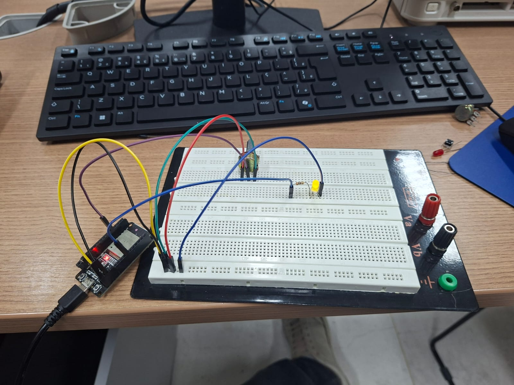
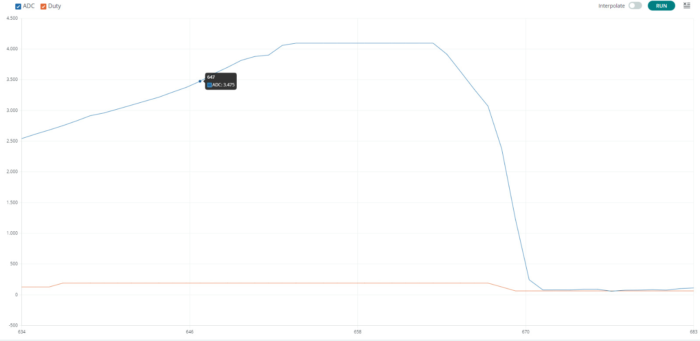
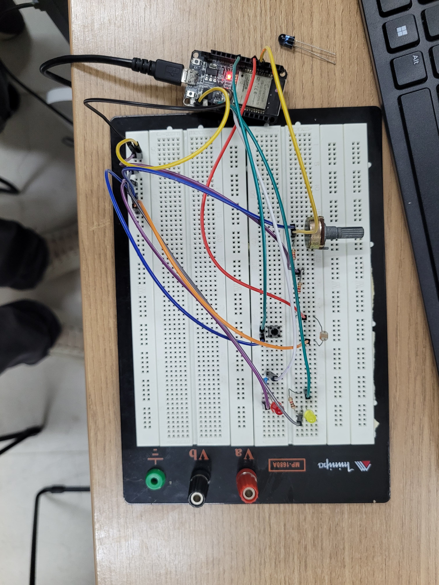
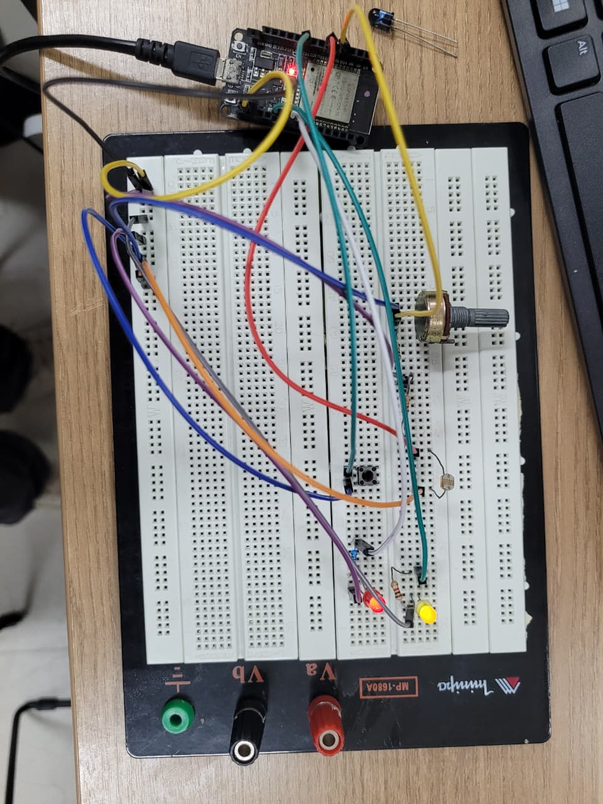

# Report 1 — Controle de LEDs com ADC e PWM

[Enunciado da atividade](HIoT_06.pdf).

## Implementação

O [código da entrega](pratica1.ino) inicia no modo manual e alterna para o automático a cada acionamento do botão, configurado com `INPUT_PULLUP`.

| Componente | GPIO | Função |
|---|---|---|
| Potenciômetro | 34 | Entrada ADC no modo manual |
| LDR | 32 | Entrada ADC no modo automático |
| Botão | 26 | Alternância entre os modos |
| LED 1 | 16 | Brilho por PWM de 5 kHz e 8 bits |
| LED 2 | 17 | Pisca com intervalo calculado a partir do ADC |

A leitura de 12 bits é convertida por `map()` de 0–4095 para PWM de 0–255 e intervalo de 100–1000 ms. O LED 2 alterna de estado usando `millis()`; quando aceso, recebe o mesmo PWM do LED 1. O monitor serial opera a 115200 bit/s e informa modo, ADC, PWM e intervalo.

Para limitar a entrada a 1 V com alimentação de 3,3 V e resistência inferior máxima de 10 kΩ, o divisor solicitado resulta em `Rsuperior = 10 kΩ × (3,3 / 1 − 1) = 23 kΩ`. Esse cálculo é a referência do projeto; os valores efetivamente montados não foram confirmados pelas fotos.

## Evidências

- Montagem e estados dos LEDs: [foto 1](image-1.jpeg), [foto 2](image-2.jpeg), [foto 4](image-4.jpeg) e [foto 5](image-5.jpeg).
- Variação das leituras ADC e do duty cycle no Serial Plotter: [captura do gráfico](image-3.jpeg).
- Implementação: [pratica1.ino](pratica1.ino).

### Fotos e capturas

