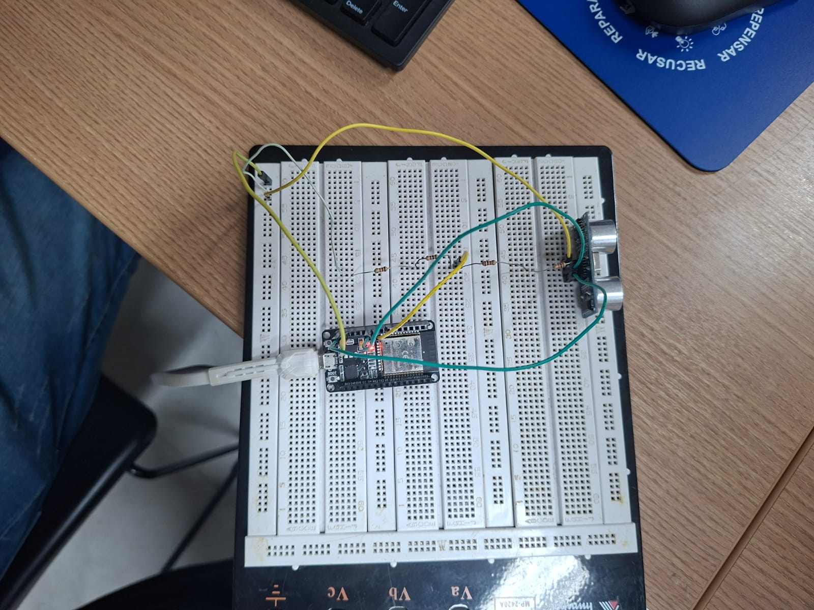
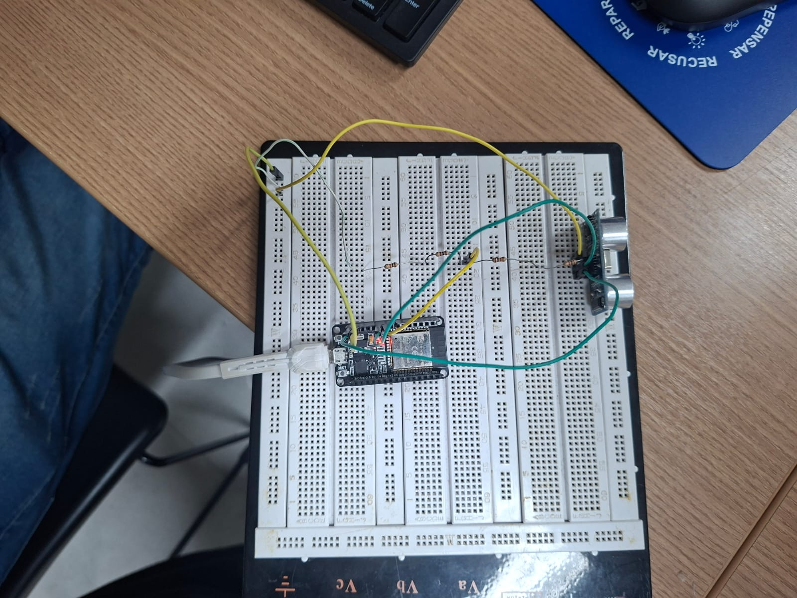
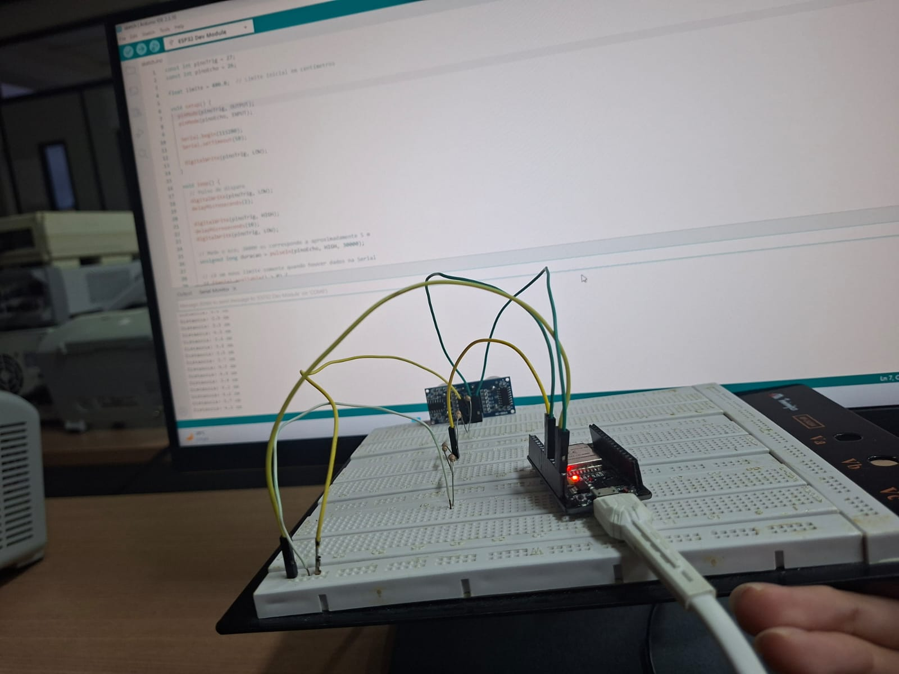
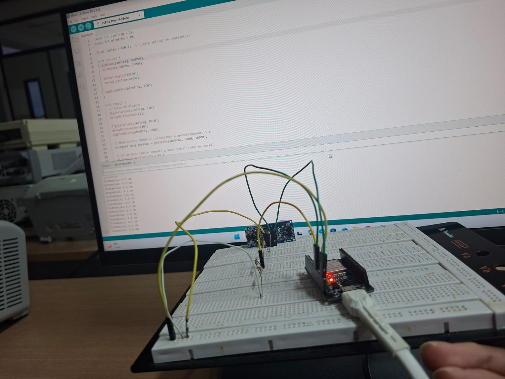
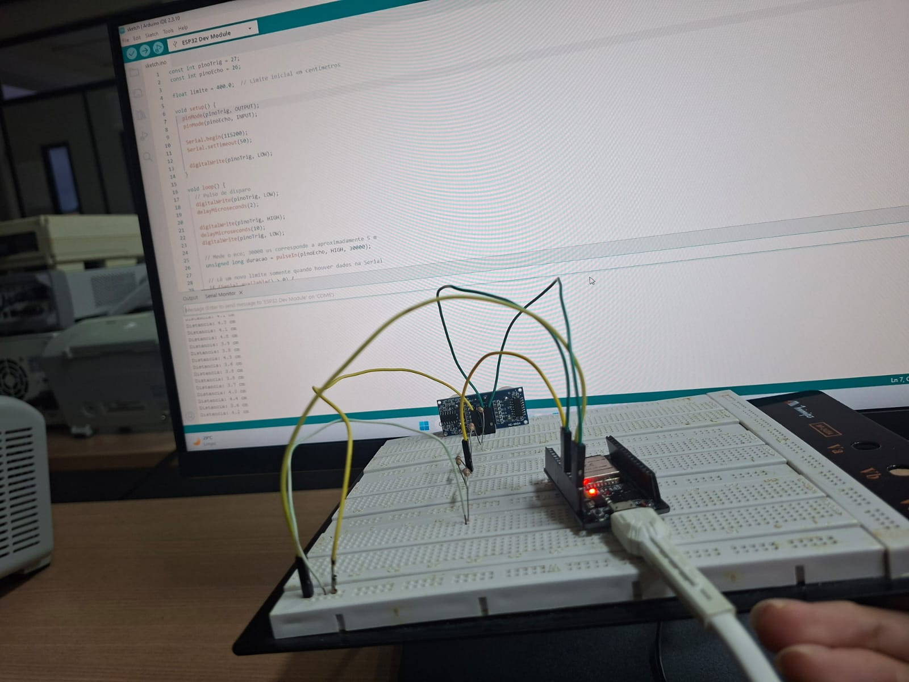

# Report 2 — Medição de distância com HC-SR04

[Enunciado da atividade](HIoT_08.pdf).

## Implementação

O [código da entrega](source.ino) envia um pulso de 10 µs ao TRIG, mede a duração do ECHO com `pulseIn()` e calcula a distância por `distância (cm) = duração (µs) × 0,0343 / 2`.

| Sinal | Ligação |
|---|---|
| TRIG | GPIO27 |
| ECHO | GPIO26, através de divisor de tensão |
| Monitor serial | 9600 bit/s |

O limite máximo é ajustado enviando um número positivo em centímetros pelo monitor serial, com terminação de linha. Por exemplo, `100` define o limite em 100 cm. Leituras abaixo de 2 cm ou acima do limite retornam `Distância = 0`; as demais são exibidas em centímetros.

O [diagrama da simulação](wokwi/diagram.json) utiliza 1,1 kΩ entre ECHO e a entrada e 2 kΩ entre a entrada e GND, conforme solicitado. Para ECHO de 5 V, a tensão calculada na entrada é `5 × 2 / (1,1 + 2) ≈ 3,23 V`.

## Evidências

- Montagem do sensor e ESP32: [foto 1](image-1.jpeg) e [foto 2](image-2.jpeg).
- Montagem diante da tela com código e saída serial: [foto 3](image-3.jpeg), [foto 4](image-4.jpeg) e [foto 5](image-5.jpeg). As fotos não permitem transcrever com segurança os valores medidos.
- Código: [source.ino](source.ino); versão da simulação em [sketch.ino](wokwi/sketch.ino).
- Simulação: [diagrama](wokwi/diagram.json) e [endereço do projeto exportado](wokwi/wokwi-project.txt).

### Fotos e capturas

