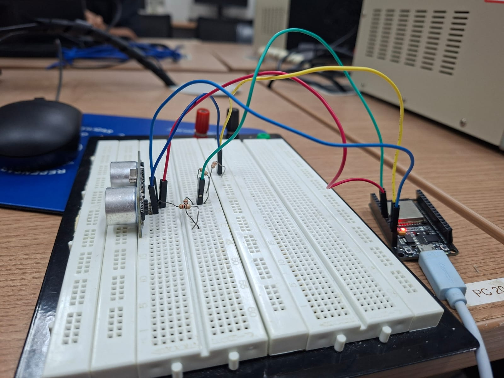
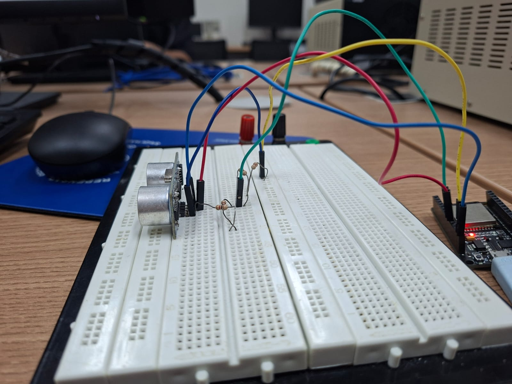
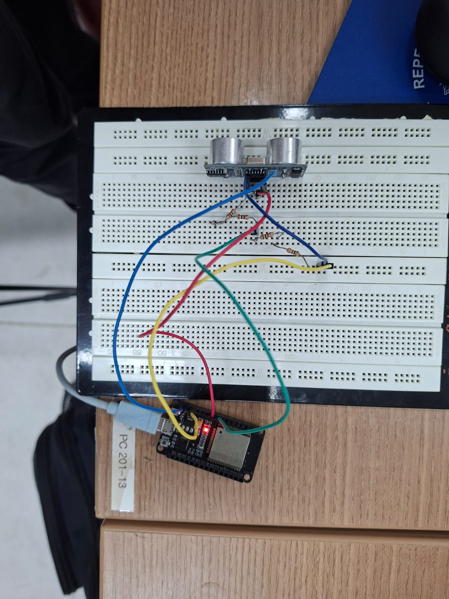

# Report 3 — Medição de distância com HC-SR04 por interrupção

[Enunciado da atividade](HIoT_11.pdf).

## Implementação

O [código-fonte](source.ino) mede a duração do pulso ECHO usando uma interrupção configurada para as duas bordas (`CHANGE`). Na subida, registra `micros()`; na descida, calcula a duração. O ESP32 envia um pulso de 10 µs ao TRIG e calcula a distância por `distância (cm) = duração (µs) × 0,0343 / 2`.

| Sinal | Ligação/configuração |
|---|---|
| TRIG | GPIO27 |
| ECHO | GPIO26, através de divisor de tensão |
| Monitor serial | 115200 bit/s |
| Intervalo entre medições | 300 ms |
| Timeout de espera pelo eco | 30000 µs |

Se não houver eco dentro do timeout, o programa informa que não houve eco ou que o objeto está fora do alcance. O enunciado especifica um divisor com resistores de 1,1 kΩ e 2 kΩ entre o ECHO de 5 V e o terra; o ponto médio deve ser ligado ao GPIO26. Com esses valores, a tensão calculada no pino é `5 × 2 / (1,1 + 2) ≈ 3,23 V`. As fotos não permitem confirmar os valores dos resistores.

## Evidências

- Fotos da montagem e execução: [foto 1](image-1.jpeg), [foto 2](image-2.jpeg) e [foto 3](image-3.jpeg). Os detalhes da ligação e os valores exibidos na serial não são legíveis o suficiente para confirmação.
- Implementação: [source.ino](source.ino).

### Fotos e capturas

